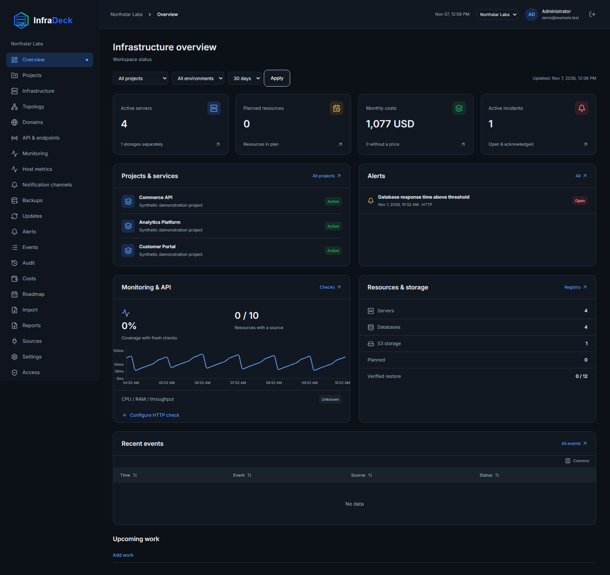
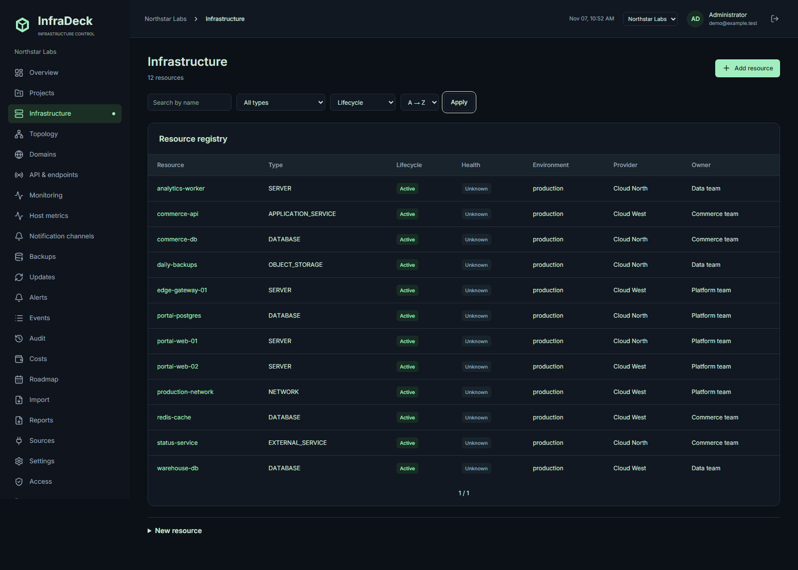
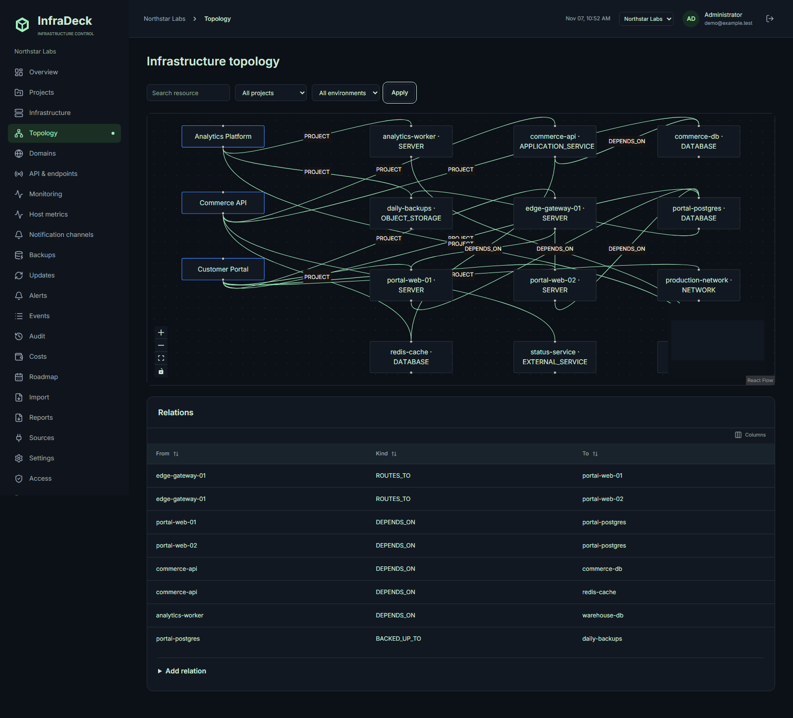

# InfraDeck

**Demo branch.** Deploy with synthetic data using `sh demo-install.sh`, or `sh demo-install.sh --domain your-domain` for HTTPS. [Deployment and login instructions](docs/demo.md).

Run your infrastructure from one place: keep track of servers, databases, dependencies, costs and availability. Deploy on your own server, add your projects and see what runs where, who owns it and what it costs.

[English](README.md) · [Русский](README.ru.md) · [Documentation](docs/README.md)

## Why InfraDeck

| Your task                             | What you get                               |
| ------------------------------------- | ------------------------------------------ |
| Find the owner of a server or service | A shared project and resource inventory    |
| Understand dependencies               | An infrastructure relationship map         |
| Track spending                        | Cost allocations and monthly budgets       |
| Catch outages                         | HTTP/TLS checks, metrics and notifications |
| Share the current picture             | CSV/XLSX import and PDF/XLSX reports       |

[English](README.md) | [Русский](README.ru.md) | [Documentation](docs/README.md) | [License](LICENSE) | [Contributing](CONTRIBUTING.md) | [Security](SECURITY.md)

Self-hosted infrastructure inventory, project costs, reports and monitoring. Your servers, your data. Licensed under AGPL-3.0-only; no vendor cloud is required.

**Current release: [0.5.0-beta.1](https://github.com/shmelevsergei/infradeck-public/releases/tag/v0.5.0-beta.1).** This is a source-build beta. English is the default for setup, sign-in, invitations and new workspaces. Russian remains selectable, and existing workspace language preferences are preserved.

## Features

- Projects, typed infrastructure resources, shared resources and dependency maps.
- Costs, allocations, monthly budgets and project-scoped access.
- CSV/XLSX import with preview; PDF/XLSX snapshot reports.
- HTTP/TLS monitoring, Prometheus-compatible sources and SSH/Sentinel metrics.
- Incident rules, maintenance windows, Alertmanager and email/Telegram/Discord adapters.
- Workspace/project roles, invitations, read API tokens and audit history.

Ordinary SSH/Sentinel is available. Automatic S3 backup/restore execution and SSH key rotation are **experimental and disabled by default**. Explicit opt-in is intended for authorized disposable test targets. See [experimental settings](docs/operations.md#beta-experimental-operations) and [release scope](docs/releases/0.5.0-beta.1.md). External providers require configuration and individual verification. Published registry images are not included in this release.

## Screenshots

Synthetic demonstration data; English interface.



| Infrastructure                                         | Dependency map                             |
| ------------------------------------------------------ | ------------------------------------------ |
|  |  |

[Projects](docs/screenshots/projects.png) · [Costs](docs/screenshots/costs.png) · [Monitoring](docs/screenshots/monitoring.png) · [Domains](docs/screenshots/domains.png) · [Mobile](docs/screenshots/dashboard-mobile.png)

## Quick start

On a Linux server, install Git and Docker Engine with Compose v2. No host Node.js or npm is required: configuration and source builds run in containers. Prebuilt application images are not published for this beta.

```sh
git clone https://github.com/shmelevsergei/infradeck-public.git
cd infradeck-public
sh install.sh
```

Open http://localhost:3000/setup on the host, enter BOOTSTRAP_TOKEN from private .env and create your owner account. Secrets are generated automatically and preserved on subsequent runs. For a remote host, use HTTPS below or an SSH tunnel: ssh -L 3000:localhost:3000 user@server.

### HTTPS without buying a domain

Replace dots in your server's public IPv4 with dashes: 203.0.113.10 → 203-0-113-10.sslip.io. This is an example; substitute your actual IP. [sslip.io](https://sslip.io/) resolves the embedded IP without domain registration.

```sh
sh install.sh --domain 203-0-113-10.sslip.io
```

Open https://203-0-113-10.sslip.io/setup with your IP. Bundled Caddy obtains and renews certificates and redirects HTTP to HTTPS. Allow inbound TCP 80/443 in the host and provider firewalls, keep these ports free, and allow outbound DNS and certificate authority access. Issuance depends on domain validation and CA rate limits.

For your own domain, point an A record for deck.example.com to the public IPv4, wait for DNS propagation, then run sh install.sh --domain deck.example.com. Add AAAA only when IPv6 reaches this server correctly.

The installer saves INFRADECK_DOMAIN, BETTER_AUTH_URL and COMPOSE_FILE in .env, so subsequent docker compose up -d --build commands also start Caddy. Certificates persist in a dedicated volume. No Docker socket is mounted. If you already run a reverse proxy, use it and set the matching BETTER_AUTH_URL instead. See [Caddy automatic HTTPS](https://caddyserver.com/docs/automatic-https).

## Alternative: install with host Node.js

Requirements: Docker Engine with Docker Compose, Node.js 24 (validated with 24.18.0), and npm 12.0.1. Container builds were validated on Linux amd64.

Clone this repository or extract the source archive into an empty directory:

```sh
git clone https://github.com/shmelevsergei/infradeck-public.git
cd infradeck-public
npm ci
npm run install:local
```

On Windows, use `npm.cmd` if PowerShell blocks the npm script.

The installer generates random secrets in a private `.env`, preserves existing configuration, and builds/starts Docker Compose. Open http://localhost:3000/setup, enter the `BOOTSTRAP_TOKEN` from your local `.env`, and create the workspace and owner. There is no public registration or default password.

Keep `.env` private: restrict it to its owner (mode 600 on Linux; owner-only ACL on Windows). PostgreSQL and Redis use persistent named volumes and do not publish ports. The web interface binds to loopback by default. For external access, configure an HTTPS reverse proxy and the matching `BETTER_AUTH_URL`.

### Optional unattended administrator setup

```sh
npm run install:local -- --prepare
```

Set both `INFRADECK_INIT_ADMIN_EMAIL` and `INFRADECK_INIT_ADMIN_PASSWORD` in the private `.env`, then run `npm run install:local`. Use a 12-128 character password without surrounding whitespace.

Optional settings: `INFRADECK_INIT_ADMIN_NAME` (Administrator), `INFRADECK_INIT_WORKSPACE_NAME` (InfraDeck), `INFRADECK_INIT_TIMEZONE` (UTC), and `INFRADECK_INIT_LOCALE` (en). Migrations finish before initialization and application startup. Initialization creates one OWNER with export permission. Repeating initialization does not reset existing accounts or passwords. Without the two credentials, the normal setup wizard remains available.

After initialization, remove the two INIT credential variables and recreate the migration container to remove them from its environment. Preserve all other secrets.

## Updates, backup and recovery

Follow [operations](docs/operations.md) before updating. Back up the metadata database and preserve the corresponding `.env` / `ENCRYPTION_KEY`. Reports are stored in the database and included in metadata backups. Reverting a Docker image does not revert schema migrations.

```sh
npm run backup:metadata -- --verify-restore
npm run update:local
```

The metadata backup command is independent of the experimental S3 executor. Recover a lost administrator password using the documented `admin:reset` procedure. Do not put credentials in issues or resource notes.

## Local development

```sh
npm ci
npm run install:local -- --prepare --local
docker compose -f compose.yaml -f deploy/compose.local.yaml up -d postgres redis
npm run db:generate
npm run db:migrate
npm exec playwright install chromium
npm run dev
```

Run `npm run worker` and `npm run runner` in separate terminals. Production Compose starts both automatically.

## Validation

```sh
npm run typecheck
npm run lint
npm run build
node --import tsx scripts/release-isolated-check.ts
```

The isolated release driver creates dedicated PostgreSQL/Redis fixtures and checks migrations, metadata recovery, domain/database behavior and E2E workflows. It requires Docker and local Chromium. Never run standalone database/E2E tests against a working production database.

For further information, see [architecture](docs/architecture.md), [user guide](docs/user-guide.md), [SSH/Sentinel](docs/managed-servers.md), [access control](docs/access.md) and [roadmap](docs/roadmap.md). Some detailed documentation is currently in Russian.
