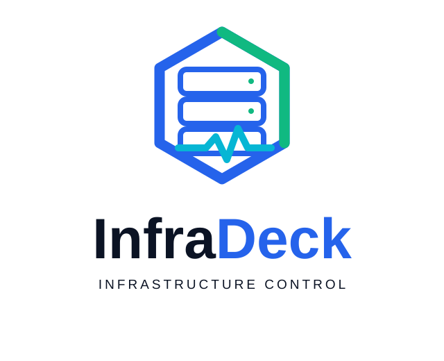
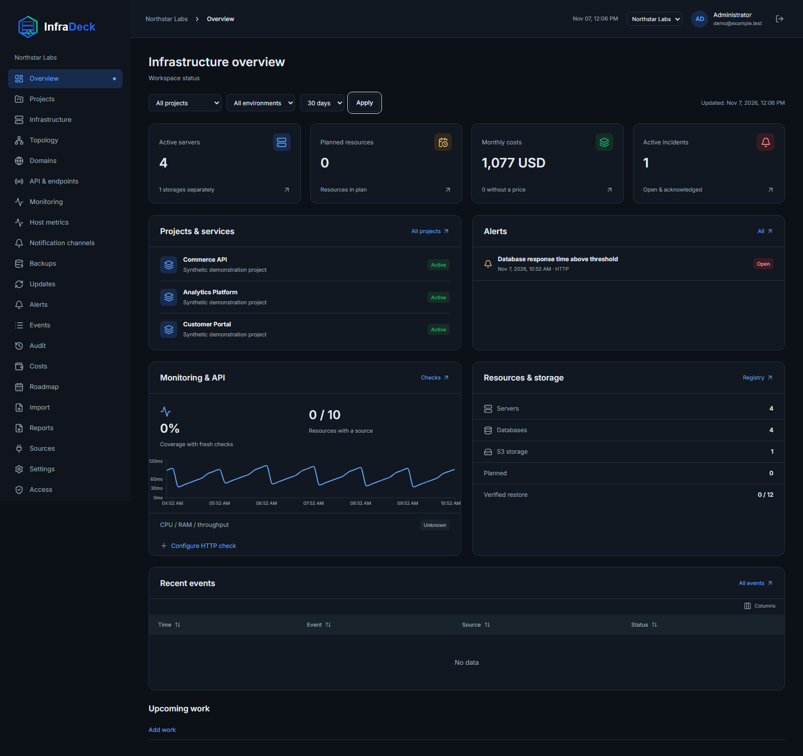
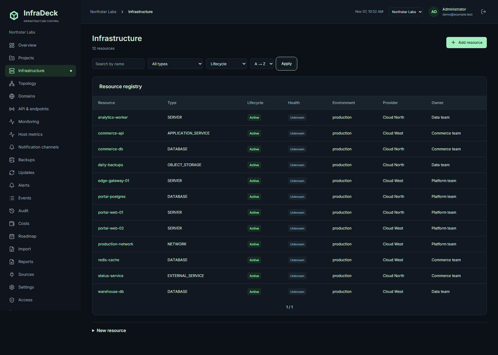
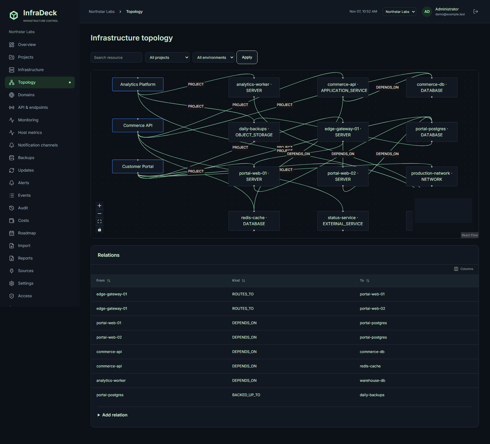

<p align="center">
  <picture>
    <source media="(prefers-color-scheme: dark)" srcset="docs/images/logo-dark.svg">
    <source media="(prefers-color-scheme: light)" srcset="docs/images/logo-light.svg">
    
  </picture>
</p>

<p align="center">
  <strong>Собственная веб-панель для управления IT-инфраструктурой</strong> — храните серверы, базы данных и сервисы в одном реестре, отслеживайте зависимости, расходы и доступность. Общая картина проектов и ресурсов на вашем сервере, без обязательного облака автора.
</p>

<p align="center">
  <a href="README.md">English</a> · <a href="README.ru.md">Русский</a>
</p>

<p align="center">
  <a href="LICENSE"></a>
  
  
  
  
</p>

<p align="center">
  <a href="CHANGELOG.md">Список изменений</a> ·
  <a href="https://github.com/shmelevsergei/infradeck-public/releases">Релизы</a> ·
  <a href="docs/README.md">Документация</a> ·
  <a href="CONTRIBUTING.md">Участие</a> ·
  <a href="SECURITY.md">Безопасность</a>
</p>

---

**Язык приложения по умолчанию — English (en).** Русский можно выбрать при настройке и в рабочем пространстве. Существующие языковые настройки сохраняются.

**0.5.0-beta.1:** бета со сборкой из исходников. Публичные образы приложения пока не опубликованы. Обычный SSH/Sentinel доступен; S3-исполнение и ротация SSH-ключей экспериментальны и выключены по умолчанию. [Область релиза](docs/releases/0.5.0-beta.1.md).

## Зачем InfraDeck

| Задача                              | Что даёт панель                          |
| ----------------------------------- | ---------------------------------------- |
| Найти владельца сервера или сервиса | Реестр ресурсов и проектов               |
| Понять зависимости                  | Карта связей инфраструктуры              |
| Следить за расходами                | Распределение затрат и месячные бюджеты  |
| Узнать о сбое                       | HTTP/TLS-проверки, метрики и уведомления |
| Подготовить отчёт                   | Импорт CSV/XLSX и экспорт PDF/XLSX       |

Также доступны проектные права, приглашения, API-токены чтения и аудит, Prometheus-совместимые источники, Alertmanager и каналы email/Telegram/Discord. Внешние подключения требуют настройки.

## Скриншоты

Демонстрационные данные, интерфейс на английском.



| Инфраструктура                                  | Карта зависимостей                          |
| ----------------------------------------------- | ------------------------------------------- |
|  |  |

[Проекты](docs/screenshots/projects.png) · [Расходы](docs/screenshots/costs.png) · [Мониторинг](docs/screenshots/monitoring.png) · [Домены](docs/screenshots/domains.png) · [Мобильный экран](docs/screenshots/dashboard-mobile.png)

## Быстрый старт

На Linux-сервере нужны только Git и Docker Engine с Compose v2. Node.js и npm на хосте не нужны: подготовка конфигурации и сборка выполняются в контейнерах. Образы приложения собираются из исходников.

```sh
git clone https://github.com/shmelevsergei/infradeck-public.git
cd infradeck-public
sh install.sh
```

Откройте http://localhost:3000/setup на машине с приложением. Введите BOOTSTRAP_TOKEN из приватного .env и создайте владельца. Скрипт генерирует секреты автоматически и сохраняет их при повторном запуске. Для удалённого сервера используйте HTTPS ниже либо SSH-туннель: ssh -L 3000:localhost:3000 user@server.

### HTTPS без покупки домена

Возьмите публичный IPv4 сервера и замените точки дефисами: например, 203.0.113.10 → 203-0-113-10.sslip.io. Это пример: подставьте свой IP. Сервис [sslip.io](https://sslip.io/) возвращает IP из имени; регистрировать домен не требуется.

```sh
sh install.sh --domain 203-0-113-10.sslip.io
```

Откройте https://203-0-113-10.sslip.io/setup с вашим IP. Встроенный Caddy получает и обновляет сертификат, перенаправляет HTTP на HTTPS. На сервере и в firewall провайдера откройте TCP 80/443; эти порты должны быть свободны. Сервер должен иметь доступ к DNS и центрам сертификации. Публичный сертификат зависит от проверки домена и лимитов CA.

Для собственного домена создайте A-запись deck.example.com → публичный IPv4 сервера, дождитесь обновления DNS и запустите sh install.sh --domain deck.example.com. AAAA добавляйте только при работающем IPv6 до этого сервера.

Скрипт записывает INFRADECK_DOMAIN, BETTER_AUTH_URL и COMPOSE_FILE в .env. После этого обычная команда docker compose up -d --build также включает Caddy. Сертификаты сохраняются в отдельном Docker volume; Docker socket не монтируется. При существующем reverse proxy используйте его вместо встроенного и задайте соответствующий BETTER_AUTH_URL. [Как работает автоматический HTTPS](https://caddyserver.com/docs/automatic-https).

## Альтернатива: установка с Node.js на хосте

Требуются Docker Compose, Node.js 24 и npm 12.0.1:

```sh
npm ci
npm run install:local
# Для встроенного HTTPS:
# npm run install:local -- --domain deck.example.com
```

В PowerShell используйте npm.cmd, если npm блокируется политикой выполнения. PostgreSQL и Redis хранят данные в volumes и не публикуют порты; веб-интерфейс привязан к localhost. Для Windows разделитель COMPOSE_FILE — точка с запятой.

## Настройка и эксплуатация

Первый запуск открывает мастер /setup: создайте рабочее пространство и владельца. Публичной регистрации и стандартного пароля нет. Для автоматической инициализации, обновления, восстановления, локальной разработки и проверок см. [английское руководство](README.md#optional-unattended-administrator-setup) и [эксплуатацию](docs/operations.md).

Сохраняйте .env и ENCRYPTION_KEY вместе с резервной копией БД. Ограничьте доступ к .env владельцем. Перед обновлением сделайте резервную копию; откат образа не откатывает миграции.

[Руководство пользователя](docs/user-guide.md) · [SSH/Sentinel](docs/managed-servers.md) · [Права доступа](docs/access.md) · [Архитектура](docs/architecture.md) · [Планы](docs/roadmap.md)
